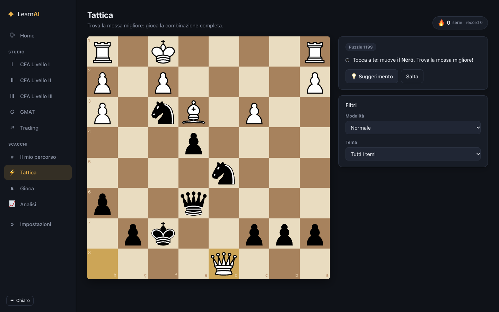
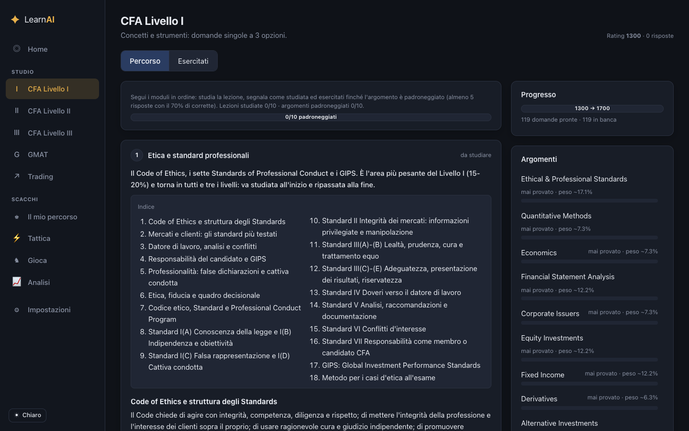

<div align="center">

# ✨ LearnAI

**A local, adaptive personal coach for chess (road to 2000 Elo) and CFA® / GMAT™ exam prep.**

One learning engine (Glicko-2 ratings, per-topic weakness tracking, an explanation for every mistake) applied to three very different subjects.


</div>

<p align="center">
  
  
</p>

## Features

### ♞ Chess
- **My path**: puzzle and game ratings (Glicko-2), level, distance to the target Elo, today's training plan and weak themes.
- **Tactics**: tens of thousands of [Lichess](https://database.lichess.org/) puzzles (CC0) matched to your rating, with hints, theme filters (fork, pin, mate in 2, ...) and an explanation of the solution.
- **Play**: games against Stockfish from 600 to 2800 Elo (`UCI_LimitStrength` plus skill-level/MultiPV sampling below 1320).
- **Analysis**: engine review of your games: accuracy, move classification (best / inaccuracy / mistake / blunder), evaluation graph, best-move arrows and a plain-language explanation of each error. PGN import from Lichess or Chess.com.
- **CPU-aware engine**: a single shared Stockfish process started on demand and stopped after 5 idle minutes; Eco / Balanced / Performance profiles.

### 📚 CFA Levels I–III and GMAT Focus
- Multiple-choice questions generated by **Claude** on syllabus topics, calibrated to your rating and focused on your weakest areas, then cached locally.
- Structured study path: lessons per topic, "mastered" criteria (≥ 5 answers at ≥ 70%), topic weights matching the exam.
- Questions in English (as in the exam), explanations in Italian.

## Architecture

| Part | Tech |
|---|---|
| Engine | Stockfish via UCI with `python-chess` |
| Backend | Python 3.11, FastAPI + uvicorn, SQLite |
| Frontend | Vite + React 19 + TypeScript, `react-chessboard`, `chess.js`, `recharts` |
| AI | Anthropic Claude API (optional, only for question generation and richer explanations) |
| Packaging | Self-contained macOS `.app` bundling Python, Stockfish and the built UI |

```
backend/   FastAPI app: rating model, puzzle selection, game analysis, study engine, tests
frontend/  React SPA (mock API mode for UI work: npm run dev:mock)
macapp/    build script for the native macOS app
docs/      architecture and API contract
```

Everything runs locally: chess works fully offline; your data stays in a local SQLite database.

## Quick start

```bash
brew install stockfish python@3.11 node
git clone https://github.com/GiuseppeSavoia/learnai.git && cd learnai

# backend + Lichess puzzle import (first time only)
cd backend && python3.11 -m venv .venv && .venv/bin/pip install -r requirements.txt
.venv/bin/python scripts/import_puzzles.py && cd ..

./start.sh            # installs frontend deps if needed, starts backend (:8000) and UI (:5173)
```

Optional, for CFA/GMAT question generation:

```bash
export ANTHROPIC_API_KEY="your-key"
```

Tests: `cd backend && .venv/bin/python -m pytest`

## Documentation

- 🇮🇹 [Full user guide (Italian)](docs/GUIDA.md)
- [Architecture and API contract](docs/ARCHITECTURE.md)

<sub>CFA® is a registered trademark of CFA Institute and GMAT™ of GMAC. This project is not affiliated with or endorsed by either. The interface is in Italian.</sub>

---

<sub>Built by <a href="https://github.com/GiuseppeSavoia">Giuseppe Savoia</a>.</sub>
